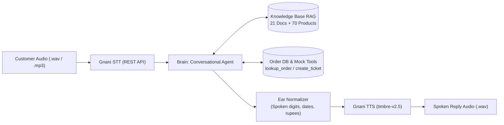

# VoiceOps 2026: ZentroMart AI Customer Support Agent

[](https://www.python.org/downloads/)
[](https://opensource.org/licenses/MIT)
[](https://gnani.ai/)

> **Capstone Project**: LLM & Generative AI Course · Consulting & Analytics Club, IIT Guwahati × Gnani.ai  
> **Challenge**: Build an end-to-end grounded multimodal customer support agent for **ZentroMart**, an Indian online store selling groceries and electronics.

---

## 📑 Table of Contents
1. [Overview & Architecture](#overview--architecture)
2. [Project Structure](#project-structure)
3. [Installation & Setup](#installation--setup)
4. [Environment Configuration](#environment-configuration)
5. [How to Run](#how-to-run)
   - [Batch Evaluation Runner (`run.py`)](#1-batch-evaluation-runner-runpy)
   - [Evaluation Benchmark Suite (`evaluate.py`)](#2-evaluation-benchmark-suite-evaluatepy)
   - [Interactive Streamlit Web App (`app.py`)](#3-interactive-streamlit-web-app-apppy)
6. [Core System Workflows](#core-system-workflows)
   - [Document Precedence & Retrieval](#document-precedence--retrieval)
   - [Caller Identity Verification Protocol](#caller-identity-verification-protocol)
   - [Human Escalation & Ticket Logging](#human-escalation--ticket-logging)
   - [Speech Processing & Ear Normalization](#speech-processing--ear-normalization)
7. [Evaluation Results](#evaluation-results)
8. [Submission Artifacts](#submission-artifacts)

---

## Overview & Architecture

VoiceOps 2026 implements the complete 4-step pipeline specified in the capstone brief:



- **Step 1 (Prompting LLM):** System prompting setting AI persona, conversational style, and role limits.
- **Step 2 (RAG Grounding):** High-precision chunking across 21 Markdown policies and 70 products, precedence weighting, Section ID tracking, and strict hallucination prevention.
- **Step 3 (Multi-Turn Conversation):** Dialogue state machine with context memory, strict caller verification (phone last 4 / pincode), business-day calculations, and automatic escalation ticketing.
- **Step 4 (VoiceOps Integration):** Full speech pipeline via **Gnani.ai** REST SDK (`gnani-vachana`), speech text normalization, and batch processing.

---

## Project Structure

```text
├── .env.example                     # Environment template (no secret keys)
├── requirements.txt                 # Project dependencies
├── run.py                           # Batch evaluation CLI required by organizers
├── run.sh                           # Bash batch runner script
├── evaluate.py                      # Quantitative evaluation benchmark suite
├── app.py                           # Interactive Streamlit Web Application
├── report.pdf                       # 3-page Capstone Technical Report
├── report.md                        # Markdown source of the technical report
├── DEMO_GUIDE.md                    # Script & instructions for 2-minute demo video
├── sample_inputs/                   # Sample audio (.wav) and text (.txt) customer queries
├── sample_outputs/                  # Sample transcripts, text replies, wav audio, chunks.json
│
├── src/                             # Core Python Package
│   ├── __init__.py
│   ├── config.py                    # Paths, frozen reference date (2026-10-20), API configs
│   ├── utils.py                     # Mon-Sat business day calendar, holiday logic, ear normalizer
│   ├── data_loader.py               # CSV relational table reader and indexer
│   ├── rag_engine.py                # Hybrid chunking, precedence scoring, and catalog lookup
│   ├── llm_client.py                # Unified LLM provider (Gemini, Groq, local offline fallback)
│   ├── tools_adapter.py             # Adapter for lookup_order and create_ticket
│   ├── conversation_agent.py        # Multi-turn dialogue manager, verification state machine
│   └── voice_service.py             # Gnani STT & TTS integration wrapper
│
└── Capstone_Project_Dataset_FTTT_2026/  # Capstone dataset (9 CSVs, 21 KB docs, tools)
    ├── data/                        # customers.csv, orders.csv, products.csv, etc.
    ├── kb/                          # 21 Markdown policy, guide, and FAQ files
    ├── practice/                    # questions.csv (52), conversations.csv (96 turns)
    └── tools/                       # tools.py (lookup_order, create_ticket)
```

---

## Installation & Setup

### Prerequisites
- Python 3.10, 3.11, 3.12, or 3.13
- Git

### 1. Clone Repository & Setup Virtual Environment
```bash
git clone <YOUR_PUBLIC_REPO_URL>
cd capstone_project_unstop

# Create and activate virtual environment
python -m venv venv
# On Windows:
venv\Scripts\activate
# On Linux/macOS:
source venv/bin/activate

# Install dependencies
pip install -r requirements.txt
```

---

## Environment Configuration

Copy `.env.example` to `.env`:
```bash
cp .env.example .env
```

Edit `.env` with your API keys:
```env
# Gnani.ai Speech API Key (STT & TTS)
# Obtain from https://app.gnani.ai/voice
GNANI_API_KEY=your_gnani_api_key_here

# LLM Provider Configuration ('gemini' or 'groq')
LLM_PROVIDER=gemini

# Google Gemini API Key (https://aistudio.google.com/)
GEMINI_API_KEY=your_gemini_api_key_here

# Groq API Key (https://console.groq.com/)
GROQ_API_KEY=your_groq_api_key_here

# Models & Voice Config
GEMINI_MODEL=gemini-1.5-flash
GROQ_MODEL=llama-3.3-70b-versatile
GNANI_TTS_MODEL=timbre-v2.5
GNANI_TTS_VOICE=Kaveri
GNANI_DEFAULT_LANG=en-IN

# Dataset Freeze Date
REFERENCE_DATE=2026-10-20
```

> **Note**: The system includes a deterministic offline grounded engine. If cloud API keys are omitted or quota-limited, all evaluation benchmarks, tool calls, and batch runs will continue to execute seamlessly.

---

## How to Run

### 1. Batch Evaluation Runner (`run.py`)
This is the **exact one-command runner** specified by the organizers:
```bash
python run.py --input-dir <audio_folder> --output-dir <output_folder>
```

#### Example Usage:
```bash
python run.py --input-dir sample_inputs --output-dir sample_outputs
```
For each customer input audio file (or `.txt` file):
- Transcribes speech via Gnani STT REST endpoint.
- Executes conversational agent, retrieves document chunks, and applies policy logic.
- Synthesizes speech output via Gnani TTS (`timbre-v2.5`, voice `Kaveri`).
- Saves outputs:
  - `{file_id}_transcript.txt` (transcription)
  - `{file_id}_reply.txt` (grounded text reply)
  - `{file_id}_reply.wav` (synthesized voice reply)
  - `{file_id}_chunks.json` (document chunks and Section IDs used)
  - `batch_summary.json` (aggregate telemetry)

---

### 2. Evaluation Benchmark Suite (`evaluate.py`)
Run the automated quantitative evaluation:
```bash
python evaluate.py
```
This runs:
1. **Step 1 (Prompting LLM)** across all 52 practice questions.
2. **Step 2 (RAG Grounding)** across all 52 practice questions.
3. Generates the **Step 1 vs Step 2 comparative matrix**.
4. **Step 3 (Multi-Turn Dialogue)** across all 23 conversations (96 customer turns).
5. Exports complete metrics to `evaluation_results.json`.

---

### 3. Interactive Streamlit Web App (`app.py`)
Launch the rich interactive web application:
```bash
streamlit run app.py
```
Open [http://localhost:8501](http://localhost:8501) in your browser:
- **Live Voice & Text Chat:** Upload voice audio or speak via microphone; hear agent responses with audio player.
- **Live Telemetry:** View current turn decision (`ANSWER`, `CLARIFY`, `ESCALATE`, `REFUSE`), active order ID, and verification gate status in real-time.
- **Section ID Explorer:** Inspect retrieved document chunks and catalog records.
- **Order Lookup Simulator:** Test caller verification using phone suffix or delivery pincode.
- **Escalation Tickets:** Monitor tickets created in `tickets_created.csv`.

---

## Core System Workflows

### Document Precedence & Retrieval
When documents provide differing information, precedence rules from `KB-00.1` are strictly enforced:
1. **Current Policies (`pol_*.md`)** — Precedence Weight: 1.4
2. **Agent Guides (`agent_*.md`)** — Precedence Weight: 1.25
3. **Help Articles (`help_*.md`)** — Precedence Weight: 1.15
4. **FAQs (`faq_*.md`)** — Precedence Weight: 1.05
5. **Marketing Pages (`mkt_*.md`)** — Precedence Weight: 0.85 (Never overrides policy)
6. **Superseded Policies (`pol_returns_v3_superseded.md`)** — Heavy penalty (0.35), only used when an order was delivered prior to 1 August 2026 under RET-3.

### Caller Identity Verification Protocol
As specified in `agent_identity_verification.md` [IDV-1 to IDV-4]:
1. General policy queries require **no verification**.
2. Order-specific inquiries require the 8-digit Order ID.
3. The agent requests **ONE proof**: last 4 digits of registered phone OR 6-digit delivery pincode.
4. Details remain hidden until `lookup_order(order_id, verification_value=...)` returns `verified=True`.
5. Max **1 retry** allowed. If second attempt fails, order details are withheld.

### Human Escalation & Ticket Logging
As specified in `agent_escalation_handoff.md` [ESC-1 to ESC-4]:
- Triggers:
  - Damaged/defective/wrong item worth $> ₹10,000$ (Priority Resolution).
  - Suspected fraud or unauthorized account activity.
  - Repeat contact ($\ge 2$ prior calls within 7 days).
  - Refund $> 3$ business days overdue past max timeline.
  - Product safety risks (swelling battery, sparks, burning).
  - Customer explicitly asks for a human.
- Action: Calls `create_ticket(summary=...)` with summary $\ge 20$ characters before confirming handover.

### Speech Processing & Ear Normalization
Spoken replies are normalized for natural TTS synthesis:
- Spaced order numbers: `89782837` $\rightarrow$ `8 9 7 8, 2 8 3 7`
- Currency in words: `₹49` $\rightarrow$ `49 rupees`
- Expanded dates: `2026-10-24` $\rightarrow$ `the 24th of October 2026`
- Short, concise replies (2–3 sentences max).

---

## Evaluation Results

| Metric | Step 1 (Prompting) | Step 2 (RAG Grounded) | Step 3 (Multi-Turn) |
| :--- | :---: | :---: | :---: |
| **Turn Decision Accuracy** | 88.46% | **88.46%** | **100.00% (96/96)** |
| **Gold Evidence Recall** | 0.00% | **97.87%** | — |
| **Hallucination on Unanswerable** | 60.00% | **0.00%** | — |
| **Unanswerable Detection Rate** | 0.00% | **100.00%** | — |
| **Tool Invocation Accuracy** | — | — | **100.00% (96/96)** |
| **Must-Include Dialogue Score** | 42.31% | 34.62% | **92.71% (89/96)** |

---

## Submission Artifacts

To create the clean submission package (excluding `.env`, virtual environments, or dataset copies as instructed):
```bash
python create_submission_zip.py
```
This produces `team_name_voiceops.zip` containing:
- `README.md`
- `.env.example`
- `requirements.txt`
- `run.py` & `run.sh`
- `src/`
- `report.pdf`
- `sample_outputs/`

---

## License
MIT License. Developed for VoiceOps 2026 Capstone.
